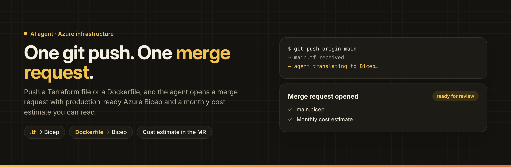

<p align="center"></p>

```
  ____            _   _____    ____  _
 |  _ \ _   _ ___| |_|_   _|__| __ )(_) ___ ___ _ __
 | |_) | | | / __| '_ \| |/ _ \  _ \| |/ __/ _ \ '_ \
 |  __/| |_| \__ \ | | | | (_) | |_) | | (_|  __/ |_) |
 |_|    \__,_|___/_| |_|_|\___/|____/|_|\___\___| .__/
     _             _     _ _            _       |_|
    / \   _ __ ___| |__ (_) |_ ___  ___| |_
   / _ \ | '__/ __| '_ \| | __/ _ \/ __| __|
  / ___ \| | | (__| | | | | ||  __/ (__| |_
 /_/   \_\_|  \___|_| |_|_|\__\___|\___|\___|
```

# PushToBicep Architect

[](LICENSE)
[](scripts)
[](scripts)
[](tests/test_local.py)
[](agent-config.yml)
[](examples/generated_main.bicep)

**One git push. One AI agent. One Merge Request with production-ready Azure Bicep and a monthly bill you can actually read.**

---

## Why I Built This

I spend my days inside the Microsoft ecosystem. I've watched teams burn weeks translating Terraform configs into Azure Bicep by hand — copying resource names into spreadsheets, Googling SKU equivalents, arguing over cost estimates in Teams threads nobody reads. It's the kind of work that feels productive but isn't. It's toil.

So I asked a simple question: *What if a `git push` could do all of that automatically?*

This agent skips all of that. Push your `.tf` or `Dockerfile`, and it hands you back a Merge Request with valid Bicep and a cost estimate. Done.

> There are only two hard things in computer science: cache invalidation, naming things, and off-by-one errors. This agent won't help with any of those — but it handles the thing nobody ever *wants* to do.

---

## What It Solves

Cloud migrations stall because they're tedious, not because they're hard. The pattern is always the same:

1. A developer pushes generic infra code
2. A cloud engineer manually maps each resource to Azure
3. Someone writes Bicep or ARM templates from scratch
4. Another person estimates costs in a calculator tab they'll never find again
5. Somebody eventually opens a branch and a review

This agent collapses all five steps into one automated pipeline.

---

## Who It's For

- **Platform teams** migrating workloads to Azure who are tired of doing it resource by resource
- **Engineering leads** who want cost visibility *before* code ships, not after the invoice arrives
- **Solo devs and small teams** who don't have a dedicated cloud architect but still need production-grade Bicep

If you've been putting off a twenty-minute Terraform conversion for three weeks, you already know you need this.

---

## How It Works

```
 ╔══════════════════════════════════════════════════════════════════╗
 ║                        THE PIPELINE                             ║
 ╚══════════════════════════════════════════════════════════════════╝

  $ git push origin main
      │
      │  *.tf or Dockerfile detected
      ▼
  ┌─────────────┐     ┌──────────────────┐     ┌─────────────────┐
  │ ░░ DETECT ░░ │────▶│ ░░ GENERATE ░░░░ │────▶│ ░░ PUBLISH ░░░ │
  │             │     │                  │     │                 │
  │ CI scans    │     │ Duo Agent reads  │     │ GitLab API:     │
  │ the diff    │     │ your infra code  │     │                 │
  │ for infra   │     │ and thinks like  │     │  ► new branch   │
  │ files       │     │ a cloud architect│     │  ► commit .bicep│
  │             │     │                  │     │  ► open MR with │
  │             │     │  ► maps to Azure │     │    cost table   │
  │             │     │  ► writes .bicep │     │                 │
  │             │     │  ► estimates $   │     │                 │
  └─────────────┘     └──────────────────┘     └─────────────────┘
                                                       │
                                                       ▼
                                               ┌─────────────────┐
                                               │  📋 MERGE        │
                                               │  REQUEST         │
                                               │  in your inbox   │
                                               │                  │
                                               │  • Resource map  │
                                               │  • Cost estimate │
                                               │  • Valid .bicep  │
                                               │  • Deploy cmds   │
                                               └─────────────────┘
```

Three stages. Zero manual steps. The MR lands in your inbox ready to review.

---

## Example

```
 ╔══════════════════════════════════════════════════════════════════╗
 ║                    BEFORE  ──►  AFTER                           ║
 ╚══════════════════════════════════════════════════════════════════╝

   AWS Terraform (input)              Azure Bicep (output)
  ┌──────────────────────┐           ┌──────────────────────────┐
  │ aws_instance.web     │ ────────► │ Container App            │
  │   t3.medium          │           │   1 vCPU / 2 GiB  ~$36  │
  ├──────────────────────┤           ├──────────────────────────┤
  │ aws_db_instance      │ ────────► │ PostgreSQL Flexible      │
  │   .postgres (RDS 15) │           │   Standard_B1ms    ~$25  │
  ├──────────────────────┤           ├──────────────────────────┤
  │ aws_s3_bucket        │ ────────► │ Storage Account          │
  │   .assets            │           │   Standard_LRS      ~$2  │
  ├──────────────────────┤           ├──────────────────────────┤
  │                      │           │ Log Analytics Workspace  │
  │                      │           │   PerGB2018          ~$5 │
  └──────────────────────┘           ├──────────────────────────┤
                                     │ TOTAL              ~$68  │
                                     └──────────────────────────┘
```

Plus a complete `.bicep` file using managed identities, Key Vault references, and diagnostic settings. See [`examples/`](examples/) for the full input/output pair.

---

## Why This Stack

| Choice | Reasoning |
|--------|-----------|
| **GitLab Duo Agent Platform** | The whole point — this is an AI agent that *acts* inside the SDLC, not a chatbot you copy-paste from |
| **Azure Bicep** | First-class Azure IaC with type safety, cleaner syntax than ARM, and native `az deployment` support |
| **Python 3.12 (stdlib only)** | Zero external dependencies means zero supply-chain risk and fast CI cold starts |
| **GitLab REST API** | Branches, commits, and MRs are all programmable — the agent doesn't just generate code, it ships it |

I didn't reach for Terraform CDK or Pulumi because the goal isn't to add another abstraction layer. The goal is to produce the simplest artifact an Azure engineer would actually trust and deploy.

> I considered writing this in Rust for performance, but then I realized the bottleneck is an LLM, not a `for` loop. Sometimes the real optimization is knowing when *not* to optimize.

---

## Reliability

A hackathon project that crashes on its second run isn't a prototype — it's a demo. This agent is built to handle the real world:

```
 ╔══════════════════════════════════════════════════════════════════╗
 ║                   WHAT DOESN'T BREAK IT                         ║
 ╚══════════════════════════════════════════════════════════════════╝

  Problem                          How it's handled
  ──────────────────────────────   ──────────────────────────────────
  Duo API returns 429 / 5xx       Exponential backoff, up to 3 retries
  Network timeout                 120s for Duo, 30s for GitLab API
  Branch already exists            409 → log + continue (idempotent)
  Bicep file already on branch    Automatic fallback: create → update
  First push (no prior SHA)       CI detects zero-SHA, diffs vs. main
  Missing API token / project ID  Fail-fast with clear error message
  Large .bicep with $ or backtick Read from file, not shell expansion
  Multiple Bicep blocks in output All fenced blocks are concatenated
```

The goal: run the pipeline twice and get the same MR updated, not a stack trace.

---

## Quick Start

### Prerequisites

- Python 3.10+
- A GitLab account (Free tier works)
- A GitLab project access token with `api` scope

### 1. Clone

```bash
git clone https://github.com/jkelleman/pushtobicep-architect.git
cd pushtobicep-architect
```

The pipeline runs on GitLab (`.gitlab-ci.yml`), so push the clone to a GitLab project to use it.

### 2. Set CI/CD Variables

In **Settings → CI/CD → Variables**, add:

| Variable | Required | Description |
|----------|----------|-------------|
| `GITLAB_API_TOKEN` | Yes | Project access token with `api` scope |
| `AZURE_SUBSCRIPTION_ID` | No | For deployment validation |
| `AZURE_TENANT_ID` | No | Azure AD tenant |
| `AZURE_CLIENT_ID` | No | Service Principal app ID |
| `AZURE_CLIENT_SECRET` | No | Service Principal secret |

### 3. Push and Watch

```bash
cp examples/sample_main.tf main.tf
git add main.tf && git commit -s -m "feat: add sample Terraform config"
git push origin main
```

The pipeline runs. A Merge Request appears. That's it.

### 4. Stress-Test with a Real-World Config

The `examples/` folder includes a multi-tier AWS application (`test_multitier_app.tf` + `test_Dockerfile`) modelled after a typical enterprise workload: ECS Fargate, ALB, RDS PostgreSQL, ElastiCache Redis, S3, CloudWatch, and SNS — the kind of stack a platform team asks you to migrate on a Tuesday.

```bash
cp examples/test_multitier_app.tf main.tf
cp examples/test_Dockerfile Dockerfile
git add main.tf Dockerfile && git commit -s -m "feat: migrate contoso-orders to Azure"
git push origin main
```

This exercises every mapping path in the prompt and generates a comprehensive Bicep template with Azure Container Apps, Azure Database for PostgreSQL, Blob Storage, Azure Cache for Redis, and Azure Monitor.

---

## Repo Structure

```
 ╔══════════════════════════════════════════════════════════════════╗
 ║                     WHAT'S IN THE BOX                           ║
 ╚══════════════════════════════════════════════════════════════════╝

  .
  ├── .gitignore ·························· Ignore generated/ and build artifacts
  ├── .gitlab-ci.yml ····················· CI pipeline: detect → generate → publish
  ├── agent-config.yml ·················· Duo Agent Platform config
  │
  ├── prompts/
  │   └── pushtobicep_architect.md ······ The AI prompt (persona + constraints + format)
  │
  ├── scripts/
  │   ├── invoke_duo_agent.py ··········· Calls GitLab Duo Chat API
  │   └── open_migration_mr.py ·········· Creates branch → commits → opens MR
  │
  ├── examples/
  │   ├── sample_main.tf ················ AWS Terraform (agent input)
  │   ├── sample_Dockerfile ············· Container config (agent input)
  │   ├── generated_main.bicep ·········· Azure Bicep (agent output)
  │   ├── test_multitier_app.tf ········· Multi-tier AWS app (test input)
  │   └── test_Dockerfile ··············· Node.js container (test input)
  │
  ├── tests/
  │   ├── test_local.py ················· 33 offline checks (python tests/test_local.py)
  │   └── test_e2e.py ··················· End-to-end run against a live GitLab project
  │
  ├── STATUS-REPORT.md ·················· Sprint status report
  ├── LICENSE ··························· MIT
  └── README.md
```

---

## What's Next

This is a working prototype. Here's where it goes with more time:

```
 ╔══════════════════════════════════════════════════════════════════╗
 ║                        ROADMAP                                  ║
 ╚══════════════════════════════════════════════════════════════════╝

  NOW                    NEXT                     LATER
  ───────────────────    ───────────────────────   ─────────────────────
  ✔ AWS → Azure          GCP → Azure mappings     Multi-cloud matrix
  ✔ .tf + Dockerfile     az bicep build in CI      Pulumi/CDK input
  ✔ Cost estimates       Azure Retail Prices API   Budget alerting
  ✔ Auto MR creation     Incremental MR diffs      PR-based approval flow
                         Policy guardrails          Azure Policy enforcement
                         CODEOWNERS routing         Slack/Teams notifications
```

---

## License & DCO

- **MIT License** — see [LICENSE](LICENSE)
- All commits are signed off (`git commit -s`) per GitLab's Developer Certificate of Origin requirement.

---

```
  ┌──────────────────────────────────────────────────────────┐
  │  Built with GitLab Duo · Azure Bicep · GitLab REST API   │
  │  Python 3.12 (stdlib only — zero external dependencies)  │
  │                                                          │
  │  "It works on my machine" — then we'll ship your machine │
  └──────────────────────────────────────────────────────────┘
```